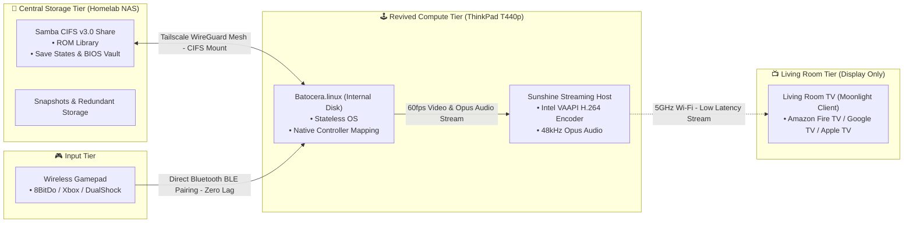

# Batocera Hardware Revival & Ephemeral Compute Guide 🕹️♻️

> **"Hardware is ephemeral. Memory is sovereign."**  
> *Transform decommissioned laptops into decoupled retro consoles with centralized NAS storage, wireless Sunshine/Moonlight TV streaming, and Tailscale mesh roaming.*

---

[](LICENSE)
[](https://batocera.org/)
[](https://app.lizardbyte.dev/)
[](https://tailscale.com/)

---

## 💡 The Philosophy: Compute is Disposable, State is Sacred

Old laptops—like a 4th-gen **ThinkPad T440p**, a retired office Dell Latitude, or a dusty HP Pavillion—are phenomenal emulation powerhouses. With sturdy cooling and capable integrated Intel HD Graphics, they run everything from NES, GBA, and PS1 up to N64, Dreamcast, and PSP at full speed.

However, running retro games entirely on a 10-to-15-year-old laptop has a fatal flaw: **Hardware mortality**.
* Aging spinning hard drives (`2.5" SATA`) suffer mechanical failure.
* Motherboards, charging ports, or solder joints die without warning.
* If your ROM library, BIOS vault, and 60-hour RPG save files live on that laptop's internal disk, **when the machine dies, your childhood memories and progress die with it.**

This guide demonstrates a **Decoupled Retro Architecture**:
1. **Ephemeral Compute:** The laptop runs [Batocera.linux](https://batocera.org/) strictly as a stateless compute engine. If the laptop smokes tomorrow, you grab any other spare laptop or desktop, plug in Batocera, and pick up right where you left off.
2. **Sovereign Storage:** All game ROMs, official BIOS files, scrapings, and save states are housed on your central home server (e.g., TrueNAS, Unraid, or an Intel NUC running [RomM](https://github.com/rommapp/romm) and Samba/CIFS) with automated RAID/ZFS snapshots and offsite backups.
3. **Wireless Living Room Gaming (Sunshine + Moonlight):** Instead of stringing long, hazardous HDMI cables across your living room floor, the laptop operates in silent **clamshell mode** (closed lid) tucked away near your router. It encodes low-latency 60fps video via **Sunshine** and streams over Wi-Fi directly to a **Moonlight** client on an Amazon Fire TV Stick, Google TV Chromecast, Apple TV, or Smart TV.
4. **Autonomous Tailscale Roaming:** Whether taking a portable live USB to a friend's house or traveling with a revived laptop, an embedded background watchdog connects to your home [Tailscale](https://tailscale.com/) mesh, mounts your central ROM library over WireGuard, and hot-reloads EmulationStation automatically.

---

## 🏛️ System Architecture



---

## 🧪 Experimental Track: Portable Roaming Live USB (Community RFC)

In addition to the primary living-room clamshell setup, we have been experimenting with a **Portable Batocera Live USB** to take on the road:
* **The Vision:** Boot any modern x86 UEFI laptop into Batocera on hotel/guest Wi-Fi and dynamically mount your central home ROM library over a private **Tailscale** WireGuard mesh.
* **What Works:** Setting `luks.enabled=0` completely stops Batocera from probing or prompting for passwords on host encrypted NVMe drives (BitLocker / LUKS).
* **Current Friction:** Tailscale daemon persistence on Batocera's read-only SquashFS, captive portal Wi-Fi delays, and CIFS mount timeouts over variable high-latency networks make this an open work-in-progress.

👉 Check out the [Tailscale Roaming Guide](docs/TAILSCALE_ROAMING_GUIDE.md) and join our open RFC to help refine the roaming scripts!

---

## 🔌 Why Sunshine + Moonlight Beats HDMI Cables

Running an HDMI cable from a laptop to the living room TV sounds easy until reality sets in:
* **The Trip Hazard:** A 10-meter HDMI cable running across carpets and hallways gets stepped on by pets and family members.
* **Controller Range Limitations:** Standard 2.4GHz USB wireless dongles or laptop Bluetooth struggle through walls and furniture when the laptop is placed far away.
* **Wasted Space:** You need a table or stand next to the TV just to hold an open laptop.

### The Headless Streaming Alternative:
1. **Closed-Lid Clamshell Operation:** The laptop sits closed, stacked neatly in a server closet, tv console cubby, or next to your network switch.
2. **Direct Gamepad Bluetooth Pairing to Batocera:** Pair your Bluetooth controllers directly to the ThinkPad running Batocera. This provides native Linux kernel controller polling, sub-millisecond input response, full rumble vibration, and authentic emulator hotkeys (Quick Save, Rewind, Fast-Forward) without the latency or button-mapping limitations of TV stick Bluetooth stacks. The TV stick acts purely as a low-latency video and audio receiver.
3. **Pristine Picture Quality:** Hardware-accelerated H.264 video streaming over 5GHz Wi-Fi or gigabit Ethernet delivers a crisp 1080p/60fps picture that looks identical to a native HDMI connection.

---

## 📂 Repository Layout

```text
.
├── README.md                                  # You are here
├── LICENSE                                    # MIT License
├── configs/
│   ├── batocera-boot.conf.example             # Network mount & LUKS bypass config
│   ├── sunshine.conf.example                  # Headless Sunshine web UI & CSRF fixes
│   └── romm-samba.docker-compose.yml.example  # Central server SMB share for RomM
├── docs/
│   ├── ARCHITECTURE.md                        # Deep dive into stateless emulation architecture
│   ├── BARE_METAL_INSTALLATION.md             # Flashing internal disks via network block streaming
│   ├── SUNSHINE_MOONLIGHT_STREAMING.md        # Headless streaming guide & controller pairing
│   └── TAILSCALE_ROAMING_GUIDE.md             # Autonomous remote roaming & host drive protection
└── scripts/
    ├── custom.sh.example                      # Autonomous Tailscale watchdog & CIFS auto-mount
    └── flash-baremetal-network.sh.example     # Stream Batocera directly to internal SATA block devices
```

---

## 🚀 Quick Setup Overview

### 1. Central Storage (Homelab Server)
Ensure your central server exposes your ROMs and BIOS directory via Samba (`SMB/CIFS`) with read and write permissions (so Batocera can write save states back to the server):
* Review [`configs/romm-samba.docker-compose.yml.example`](configs/romm-samba.docker-compose.yml.example).

### 2. Configure Batocera Network Mounting
In `/boot/batocera-boot.conf`:
```ini
sharedevice=NETWORK
sharewait=10
sharenetwork_smb1=ROMS@192.168.1.100:roms:username=batocera,password=retrogaming
sharenetwork_smb2=BIOS@192.168.1.100:bios:username=batocera,password=retrogaming
```
*(See [`configs/batocera-boot.conf.example`](configs/batocera-boot.conf.example) for detailed options)*.

### 3. Deploy Sunshine Host on Batocera
1. Install Sunshine via Flatpak:
   ```bash
   flatpak install --system dev.lizardbyte.app.Sunshine
   ```
2. Enable headless web admin access and bypass CSRF blocks by updating `sunshine.conf`.
3. Auto-start Sunshine on boot by symlinking or invoking it in `/userdata/system/custom.sh`.
4. Install **Moonlight** on your streaming TV stick, enter the PIN, and map your gamepads.
*(See [`docs/SUNSHINE_MOONLIGHT_STREAMING.md`](docs/SUNSHINE_MOONLIGHT_STREAMING.md) for full instructions)*.

### 4. Enable Autonomous Tailscale Roaming
If using a portable live USB or roaming on different networks:
1. Prevent Batocera from halting boot on encrypted host laptops:
   ```ini
   luks.enabled=0
   ```
2. Deploy our lightweight background watchdog in `/userdata/system/custom.sh` to establish Tailscale, fall back to Mesh IPs, and hot-reload EmulationStation:
   ```bash
   batocera-es-swissknife --restart
   ```
*(See [`docs/TAILSCALE_ROAMING_GUIDE.md`](docs/TAILSCALE_ROAMING_GUIDE.md))*.

---

## 🤝 Contributing

Contributions, hardware compatibility reports, and controller mappings are welcome! Please open an issue or pull request.

## 📄 License

Distributed under the [MIT License](LICENSE). Built for the homelab and hardware revival community.
