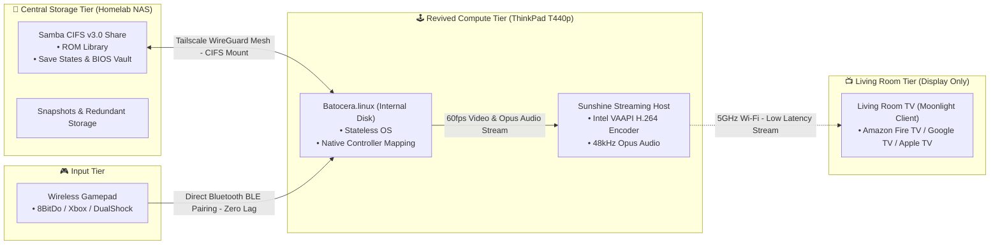

# Batocera Hardware Revival & Ephemeral Compute Guide 🕹️♻️

> **"Hardware is ephemeral. Memory is sovereign."**  
> *Transform decommissioned laptops into decoupled retro consoles with centralized NAS storage, wireless Sunshine/Moonlight TV streaming, and Tailscale mesh roaming.*

---

[](LICENSE)
[](https://batocera.org/)
[](https://app.lizardbyte.dev/)
[](https://tailscale.com/)

---

## 🏛️ System Architecture



---

## 🚀 Complete Step-by-Step Setup Guide

Follow this end-to-end walkthrough to turn any retired laptop into a headless living-room retro console.

---

### Step 1: Central Storage Setup (Homelab Server / NAS)

Expose your game ROMs, BIOS files, and saves directory via a dedicated Samba (`SMB/CIFS`) container with read and write permissions (so Batocera can write save states back to the server).

Create a `docker-compose.yml` on your media server:

```yaml
services:
  romm-samba:
    image: dperson/samba:latest
    container_name: romm-samba
    restart: unless-stopped
    ports:
      - "139:139"
      - "445:445"
    environment:
      - TZ=America/New_York
      - USERID=1000
      - GROUPID=1000
    volumes:
      - /mnt/storage/games/roms:/mount/roms:rw
      - /mnt/storage/games/bios:/mount/bios:rw
      - /mnt/storage/games/saves:/mount/saves:rw
    command: >
      -u "batocera;retrogaming"
      -s "roms;/mount/roms;yes;no;no;batocera"
      -s "bios;/mount/bios;yes;no;no;batocera"
      -s "saves;/mount/saves;yes;no;no;batocera"
      -g "inherit permissions = yes"
      -g "force create mode = 0775"
      -g "force directory mode = 0775"
```

Start the service:
```bash
docker compose up -d
```

---

### Step 2: Install Batocera on the Revived Laptop

You can run Batocera directly from a USB drive, or permanently install it to the laptop's internal hard drive/SSD.

#### Option A: Standard USB Flash (Recommended for Beginners)
1. **Download Batocera:** Grab the latest official x86_64 image from [batocera.org/download](https://batocera.org/download).
2. **Flash to USB:** Use [Raspberry Pi Imager](https://www.raspberrypi.com/software/) or [BalenaEtcher](https://etcher.balena.io/) to write the image to a USB flash drive (16GB+ recommended).
3. **Boot Target Laptop:** Plug the USB drive into your revived laptop, power on, and press your boot menu key (`F12` on ThinkPads, `F9` on HP, `F12` on Dell) to select the USB drive.

#### Option B: Built-in GUI Installer (Permanent Internal HDD/SSD Installation)
If you want to run Batocera natively on the laptop's internal drive without needing the USB thumb drive permanently plugged in:
1. Boot into the Batocera Live USB (from Option A above).
2. Connect to your Wi-Fi under **Network Settings**.
3. Press `Space` (or `Start` on a controller) to open the Main Menu.
4. Navigate to **System Settings** -> **Install Batocera on a new disk**.
5. Select your internal disk (e.g. `Internal SATA 500GB`) and target architecture (`x86_64`), then select **Install**. Batocera will automatically download the latest official image and flash the internal drive cleanly.
6. Once complete, unplug the USB drive and reboot!

> **💡 Power User Alternative:** For headless homelabbers who prefer streaming disk images over the network via CLI pipelines (`curl | gzip | dd`), see [`docs/BARE_METAL_INSTALLATION.md`](docs/BARE_METAL_INSTALLATION.md).

---

### Step 3: Decouple Storage via Network Mount (`batocera-boot.conf`)

Configure Batocera to mount your central server shares automatically on boot.

Edit `/boot/batocera-boot.conf` (or edit it directly on the FAT32 boot partition):

```ini
## Enable network storage mode
sharedevice=NETWORK
sharewait=10

## Mount central SMB shares (Use LAN IP e.g. 192.168.1.100 or Tailscale IP e.g. 100.64.0.1)
sharenetwork_smb1=ROMS@192.168.1.100:roms:username=batocera,password=retrogaming
sharenetwork_smb2=BIOS@192.168.1.100:bios:username=batocera,password=retrogaming

## Inhibit host drive LUKS discovery (prevents password prompts on encrypted drives)
luks.enabled=0
```

Reboot Batocera. All ROMs, BIOS files, and existing save states will appear in EmulationStation!

---

### Step 4: Headless Sunshine Streaming Host Setup

1. **SSH into Batocera:**
   ```bash
   ssh root@<BATOCERA_IP>
   # Default password is: linux
   ```

2. **Install Sunshine via Flatpak:**
   ```bash
   flatpak install --system dev.lizardbyte.app.Sunshine
   ```

3. **Configure Headless Web UI & Encoder Settings:**  
   Edit `/userdata/system/configs/sunshine/sunshine.conf`:
   ```ini
   port = 47989
   origin_pin_allowed = 0.0.0.0/0
   origin_web_ui_allowed = 0.0.0.0/0
   csrf_allowed_origins = https://<BATOCERA_IP>:47990,http://<BATOCERA_IP>:47990,https://localhost:47990

   # Intel VAAPI hardware acceleration (QuickSync)
   encoder = vaapi
   capture = kms
   fps = [60]
   audio_sink = auto
   ```

4. **Autostart Sunshine on Boot:**  
   Add the following line to `/userdata/system/custom.sh`:
   ```bash
   mkdir -p /userdata/system/logs
   flatpak run dev.lizardbyte.app.Sunshine > /userdata/system/logs/sunshine.log 2>&1 &
   ```
   Ensure it is executable:
   ```bash
   chmod +x /userdata/system/custom.sh
   ```

---

### Step 5: Direct Controller Pairing & Moonlight TV Client

1. **Pair Wireless Controllers Directly to Batocera:**  
   * Navigate to **Controller & Bluetooth Settings** -> **Pair a Bluetooth Device** on Batocera.
   * Put your controller (8BitDo, Xbox Wireless, PS4/PS5 DualShock) into pairing mode.
   * *Why:* Direct pairing to Batocera's Linux kernel provides sub-millisecond input response, full haptic rumble, and global emulator hotkeys (`Hotkey + Start` to exit, `Hotkey + Y` to save state).
2. **Install Moonlight on Your TV Device:**  
   * Install **Moonlight Game Streaming** from the App Store on your Amazon Fire TV Stick, Google TV Chromecast, or Apple TV.
   * Open Moonlight; it will automatically discover your Batocera Sunshine host.
   * Select the host to generate a **4-digit PIN**.
3. **Authorize the PIN:**  
   * Open `https://<BATOCERA_IP>:47990` in your phone or PC browser.
   * Navigate to the **PIN** tab, enter the 4-digit code, and click Send.
4. **Close the Laptop Lid (Clamshell Mode):**  
   Tuck the laptop away in a console or shelf. Launch Moonlight on the TV and enjoy 60fps wireless retro gaming!

---

## 💡 Why This Architecture?

### 1. The Core Philosophy: "Hardware is Ephemeral, Memory is Sovereign"
Old laptops (like a 4th-gen **ThinkPad T440p**) are amazing emulation machines, but their aging internal hardware will eventually fail:
* Old 2.5" spinning hard drives suffer mechanical failure.
* Motherboards, charging ports, or solder joints die without warning.
* If your ROMs and 60-hour RPG save files live on that laptop's internal disk, **when the machine dies, your childhood memories and save files die with it.**

**The Decoupled Solution:**
* **Compute is Disposable:** The revived laptop is treated as a stateless compute worker. If the laptop smokes tomorrow, you grab any other spare laptop or mini-PC, flash Batocera, and plug it in.
* **State is Sovereign:** All game ROMs, BIOS files, and save files live on your central NAS with automated ZFS/RAID snapshots and offsite backups. Your saves are never lost.

### 2. Why Sunshine + Moonlight Beats HDMI Cables
Running an HDMI cable from a laptop to the living room TV is a hassle:
* **The Trip Hazard:** A 10-meter HDMI cable running across carpets and hallways gets stepped on by pets and family members.
* **Controller Range Issues:** Standard 2.4GHz USB dongles or laptop Bluetooth struggle through walls and furniture when the laptop is far away.
* **Wasted Space:** You need a table or stand next to the TV just to hold an open laptop.

**The Streaming Advantage:**
* The laptop runs silently with its lid closed (**clamshell mode**), tucked into a TV console or network closet.
* Streams hardware-accelerated 1080p/60fps video over 5GHz Wi-Fi with sub-frame encoding latency.
* The TV stick acts purely as an audio/video display receiver.

---

## 📂 Repository Layout & Deep Dives

```text
.
├── README.md                                  # You are here
├── LICENSE                                    # MIT License
├── configs/
│   ├── batocera-boot.conf.example             # Network mount & anti-LUKS config
│   ├── sunshine.conf.example                  # Headless Sunshine web UI & CSRF bypass
│   └── romm-samba.docker-compose.yml.example  # Central server SMB share for RomM
├── docs/
│   ├── ARCHITECTURE.md                        # Deep dive into stateless emulation architecture
│   ├── BARE_METAL_INSTALLATION.md             # Flashing internal disks via network block streaming
│   ├── SUNSHINE_MOONLIGHT_STREAMING.md        # Headless streaming guide & controller pairing
│   └── TAILSCALE_ROAMING_GUIDE.md             # Autonomous remote roaming & host drive protection
└── scripts/
    ├── custom.sh.example                      # Autonomous Tailscale watchdog & CIFS auto-mount
    └── flash-baremetal-network.sh.example     # Stream Batocera directly to internal SATA block devices
```

---

## 🧪 Experimental Track: Portable Roaming Live USB (Community RFC)

In addition to the primary living-room clamshell setup, we have been experimenting with a **Portable Batocera Live USB** to take on the road:
* **The Vision:** Boot any modern x86 UEFI laptop into Batocera on hotel/guest Wi-Fi and dynamically mount your central home ROM library over a private **Tailscale** WireGuard mesh.
* **What Works:** Setting `luks.enabled=0` completely stops Batocera from probing or prompting for passwords on host encrypted NVMe drives (BitLocker / LUKS).
* **Current Friction:** Tailscale daemon persistence on Batocera's read-only SquashFS, captive portal Wi-Fi delays, and CIFS mount timeouts over variable high-latency networks make this an open work-in-progress.

👉 Check out the [Tailscale Roaming Guide](docs/TAILSCALE_ROAMING_GUIDE.md) and join our open RFC to help refine the roaming scripts!

---

## 🤝 Contributing

Contributions, hardware compatibility reports, and controller mappings are welcome! Please open an issue or pull request.

## 📄 License

Distributed under the [MIT License](LICENSE). Built for the homelab and hardware revival community.
