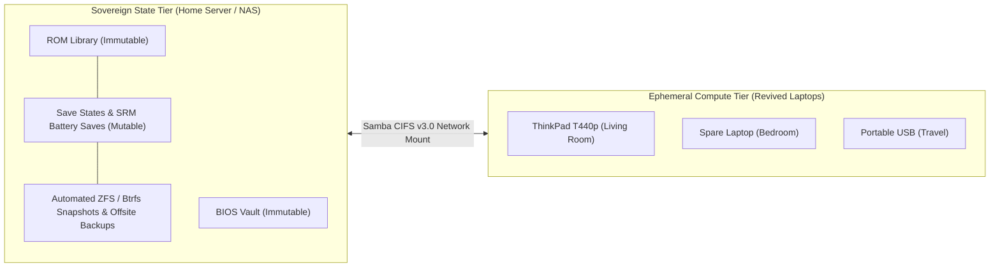

# Architecture: Decoupling Compute from State

## The Traditional Problem: Monolithic Retro Emulation

In traditional retro gaming setups, everything runs on a single physical machine:
- The OS and emulator cores are installed on the local hard drive.
- Game ROMs and BIOS files are stored on the local partition.
- Save files (`.srm`, `.state`) are written directly to local storage.

When applied to aging hardware (e.g., a 10-year-old ThinkPad T440p, an old Dell Latitude, or a thrifted mini-PC), this creates severe vulnerability:

```
[Old Laptop HDD] ---> [OS + ROMs + Saves]
      |
   (CRASH)
      v
  Total Data Loss (Lost Saves, Lost Playtime, Manual Re-setup Required)
```

Mechanical laptop drives from the 2010s often exhibit sector errors, elevated temperatures, and sudden motor seizure. Furthermore, battery swelling, power supply failure, or liquid spills can render the host hardware instantly inoperable.

---

## The Decoupled Paradigm: Ephemeral Compute, Sovereign State

In a modern homelab, storage and state belong on redundant, backed-up infrastructure. The retro console machine should be treated like an **ephemeral compute worker**:



### Key Operational Benefits:

1. **Zero-Touch Machine Swapping (Disaster Recovery in 5 Minutes):**
   If the internal drive of your primary emulation laptop dies:
   - Grab *any* other old laptop or mini-PC.
   - Insert a Batocera USB or run our network flash script.
   - Point `/boot/batocera-boot.conf` to your server's Samba share.
   - Boot up. Every game, save state, and scraped box art backdrop is immediately restored.

2. **Centralized Game Management (RomM):**
   Instead of copying gigabytes of ROMs to each individual device, all ROMs live on your media server managed by [RomM](https://github.com/rommapp/romm). You upload a game once in the web browser, and it is instantly playable across all revived machines in your home.

3. **Multi-Room Save Continuity:**
   Because save files are written back to the network share, you can start an RPG on the living room TV via the revived ThinkPad, save your game, and continue playing the exact same save file on your desktop or portable handheld.
